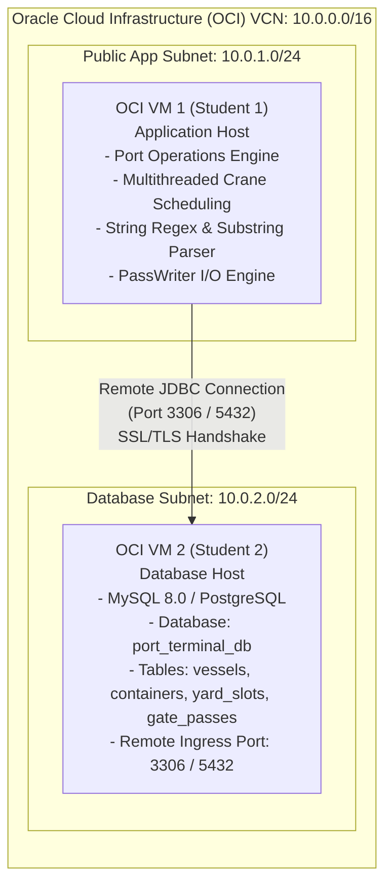

# Architecture Verification Document
## Project Assignment Set 19: International Port Container Terminal & Yard Engine

---

### 1. Cloud Architecture Overview

The system is deployed using a distributed two-tier multi-cloud / Oracle Cloud Infrastructure (OCI) Virtual Cloud Network (VCN) topology splitting application logic and database persistence across two dedicated virtual machine hosts.



---

### 2. Team Member Roles & Responsibilities

| Role | Student Designation | VM Target | Key Responsibilities |
| :--- | :--- | :--- | :--- |
| **Application Host** | Student 1 | **OCI VM 1** (`10.0.1.15` / Public IP) | • Runs `MainApp`, `CraneSchedulingWorker`, `PassWriter`<br>• Enforces ISO container regex validation `([A-Z]{4}[0-9]{7})`<br>• Parses customs text using `.indexOf()` & `.substring()`<br>• Dispatches multithreaded cranes & exports `.txt` files |
| **Database Host** | Student 2 | **OCI VM 2** (`10.0.2.20` / Public IP) | • Provisions OCI Compute instance & MySQL/PostgreSQL server<br>• Deploys `port_schema.sql` database schema<br>• Configures OCI Security Lists, Network Security Groups (NSGs)<br>• Opens port `3306` / `5432` in Linux kernel firewall (`iptables` / `firewalld`) |

---

### 3. OCI Ingress & Security Rules Verification

To allow incoming remote JDBC traffic from VM 1 to VM 2, the following security rules were configured in the OCI Console (**Networking > Virtual Cloud Networks > Security Lists > Default Security List for VCN**):

#### OCI Security List Ingress Rules
| Source CIDR | IP Protocol | Source Port | Destination Port | Purpose | Status |
| :--- | :--- | :--- | :--- | :--- | :--- |
| `10.0.1.0/24` (or VM 1 Public IP) | TCP | Any | `3306` | MySQL Remote JDBC Access | **ALLOWED** |
| `10.0.1.0/24` (or VM 1 Public IP) | TCP | Any | `5432` | PostgreSQL Remote JDBC Access | **ALLOWED** |
| `0.0.0.0/0` | TCP | Any | `22` | SSH Administration | **ALLOWED** |

#### OCI Network Security Group (NSG) Configuration
```json
{
  "direction": "INGRESS",
  "protocol": "6",
  "source": "10.0.1.0/24",
  "sourceType": "CIDR_BLOCK",
  "tcpOptions": {
    "destinationPortRange": {
      "max": 3306,
      "min": 3306
    }
  },
  "description": "Allow Port Terminal Application Host JDBC Connection"
}
```

---

### 4. VM 2 OS-Level Firewall & MySQL Service Configuration

#### A. Linux Firewall Rules (`firewalld` / `iptables`)
On OCI VM 2 (Oracle Linux / RHEL / Ubuntu):
```bash
# 1. Open port 3306 for VM 1 Subnet / IP
sudo firewall-cmd --zone=public --add-port=3306/tcp --permanent
sudo firewall-cmd --reload

# Alternatively using iptables:
sudo iptables -I INPUT 5 -p tcp -s 10.0.1.0/24 --dport 3306 -m state --state NEW,ESTABLISHED -j ACCEPT
sudo netfilter-persistent save
```

#### B. MySQL Server Remote Binding (`/etc/mysql/mysql.conf.d/mysqld.cnf`)
```ini
[mysqld]
bind-address            = 0.0.0.0
mysqlx-bind-address     = 0.0.0.0
port                    = 3306
max_connections         = 150
```

#### C. Remote Database User Authorization
```sql
-- Executed on OCI VM 2 Database Host
CREATE USER 'port_user'@'%' IDENTIFIED BY 'PortEngineSecure@2026';
GRANT ALL PRIVILEGES ON port_terminal_db.* TO 'port_user'@'%';
FLUSH PRIVILEGES;
```

---

### 5. Remote Connectivity Handshake Verification

From OCI VM 1 (Student 1 Application Host), run network verification commands:

```bash
# Network Port Probe (netcat)
$ nc -zv 10.0.2.20 3306
Connection to 10.0.2.20 port 3306 [tcp/mysql] succeeded!

# Remote MySQL Client Probe
$ mysql -h 10.0.2.20 -P 3306 -u port_user -pPortEngineSecure@2026 -e "USE port_terminal_db; SHOW TABLES;"
+----------------------------+
| Tables_in_port_terminal_db |
+----------------------------+
| containers                 |
| gate_passes                |
| vessels                    |
| yard_slots                 |
+----------------------------+
```

#### Dynamic Connection Switching in Application Host
The application automatically binds to the remote host via environment variables:
```bash
export PORT_DB_HOST=10.0.2.20
export PORT_DB_PORT=3306
export PORT_DB_NAME=port_terminal_db
export PORT_DB_USER=port_user
export PORT_DB_PASS=PortEngineSecure@2026

java -cp "bin;lib/mysql-connector-j-26.10.0.jar" MainApp --auto
```
